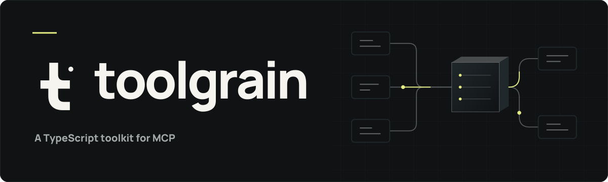

<p align="center">
  
</p>

<h1 align="center">Typed tools.<br>Composable MCP servers.</h1>

<p align="center">
  Your application logic, exposed as reusable MCP tools.<br>
  Define with Zod. Compose in TypeScript. Serve over stdio or HTTP.
</p>

<p align="center">
  <a href="https://www.npmjs.com/package/@toolgrain/mcp"></a>
  <a href="https://github.com/keshavkatwe/toolgrain/actions/workflows/ci.yml"></a>
  <a href="./docs/support-policy.md"></a>
  <a href="./docs/support-policy.md"></a>
  <a href="./docs/support-policy.md"></a>
  <a href="./LICENSE"></a>
</p>

<p align="center">
  <a href="#quickstart">Quickstart</a> ·
  <a href="./docs/README.md">Documentation</a> ·
  <a href="./apps/README.md">Examples</a> ·
  <a href="#packages">Packages</a> ·
  <a href="./.github/CONTRIBUTING.md">Contributing</a>
</p>

---

Toolgrain is a TypeScript toolkit for building [Model Context Protocol](https://modelcontextprotocol.io/)
servers. Start with a tool, compose a server, then choose how clients connect.

## Why Toolgrain?

<table>
  <tr>
    <td width="50%" valign="top">
      <h3>Types follow your schemas</h3>
      Zod infers handler inputs and checks declared outputs. Runtime parsing
      applies defaults and transforms to inputs and outputs.
    </td>
    <td width="50%" valign="top">
      <h3>Tools compose</h3>
      Reuse standalone definitions across servers. Access application dependencies
      through typed, request-cached context providers.
    </td>
  </tr>
  <tr>
    <td width="50%" valign="top">
      <h3>Choose your transport</h3>
      Start with stdio, run a Node HTTP listener, or mount a Web or Node handler
      in your application. Keep the same tool definitions.
    </td>
    <td width="50%" valign="top">
      <h3>Add authorization</h3>
      Protect HTTP endpoints with JWT or Clerk OAuth verification. Read typed,
      verified identities inside your handlers.
    </td>
  </tr>
</table>

Toolgrain implements MCP directly, independently of `@modelcontextprotocol/sdk`.
The current scope is tool discovery and execution across two protocol revisions;
see [support and scope](#support-and-scope) before choosing it for your project.

## Quickstart

### 1. Install

Use Node.js **`^24.20.0`** and a TypeScript project with **strict mode** enabled.
Install the stable `0.1.0` packages:

```sh
npm install @toolgrain/mcp@0.1.0 @toolgrain/node@0.1.0 zod@^4.6.6
npm install --save-dev typescript @types/node@^24.10.0
```

### 2. Define your tool and server

Save as `server.mts`. The registration key `greet` is the name clients use to
discover and call the tool.

```ts
import { createServer, tool } from "@toolgrain/mcp";
import { stdio } from "@toolgrain/node";
import { z } from "zod";

const greet = tool({
  description: "Greet someone by name",
  annotations: { readOnlyHint: true },
  input: z.object({ name: z.string().min(1) }),
  output: z.object({ message: z.string() }),
  execute: ({ name }) => ({ message: `Hello, ${name}!` }),
});

const server = createServer({
  name: "hello-server",
  version: "1.0.0",
  tools: { greet },
});

await server.listen(stdio());
```

### 3. Compile and run

```sh
npx tsc server.mts --strict --module NodeNext --target ES2022 --types node
node server.mjs
```

The server waits for MCP requests on stdin. Configure your MCP client to start
`node` with the absolute path to `server.mjs` as its argument. Keep application
logs on stderr.

| Call `greet` with | Receive as structured content and text |
| --- | --- |
| `{ "name": "Ada" }` | `{ "message": "Hello, Ada!" }` |

### Prefer HTTP?

Replace the `stdio` import and the last line with:

```ts
import { http } from "@toolgrain/node";

await server.listen(http({ port: 3000 }));
```

Your endpoint is `http://127.0.0.1:3000/mcp`. Call `server.close()` during
application shutdown. See [transports](./docs/transports.md) for existing
listeners, HTTP headers, production hosts, and cancellation, or start from a
[framework example](./apps/README.md).

## Build beyond hello

| You want to… | Start here |
| --- | --- |
| Reuse tools, validate outputs, or return rich content | [Tool authoring](./docs/tools.md) |
| Access request details or cancel work | [Handler context](./docs/tools.md#handler-context) |
| Inject a database or service into tools | [Context providers](./docs/context.md) |
| Protect an HTTP endpoint with JWT or Clerk | [Authorization](./docs/authorization.md) |
| Connect Inspector or check tested clients | [Compatibility](./docs/compatibility.md) |
| Use Express, Hono, Elysia, or Next.js | [Runnable examples](./apps/README.md) |

## Packages

Install Toolgrain libraries at the same version. Start with `mcp` and the
transport package your application needs; add authorization when you need it.

| Package | Purpose |
| --- | --- |
| [@toolgrain/mcp](./packages/mcp/README.md) | Tools, servers, validation, rich results, and context |
| [@toolgrain/node](./packages/node/README.md) | Stdio, managed HTTP, and Node HTTP handlers |
| [@toolgrain/http](./packages/http/README.md) | Web `Request`/`Response` handlers |
| [@toolgrain/jwt](./packages/jwt/README.md) | JWT access-token verification |
| [@toolgrain/clerk](./packages/clerk/README.md) | Clerk OAuth access-token verification |
| [@toolgrain/protocol](./packages/protocol/README.md) | Pinned MCP wire types and version constants |

## Support and scope

Stable **0.1.0** is [available on npm](https://www.npmjs.com/package/@toolgrain/mcp).

| Requirement | Supported |
| --- | --- |
| Module format | ESM |
| Node.js | `^24.20.0` |
| Bun applications | `>=1.4.4 <2` |
| TypeScript | 5.5.4+ with strict mode |
| Zod | `^4.6.6`, Classic or Mini |
| MCP | `2026-07-28` and initialization-based `2025-06-18` |

Node 26 is preview. Repository tooling uses Bun **1.3.14**, separately from the
application runtime. See the [support policy](./docs/support-policy.md).

Both protocol revisions share the same tool API over stdio and HTTP. HTTP uses
independent POST requests and JSON responses.
Sessions, SSE, resumability, resources, prompts, elicitation, progress, and
subscriptions are outside the current implementation. Check the
[client verification notes](./docs/compatibility.md) and [roadmap](./ROADMAP.md)
for tested flows and planned work.

## Contribute

Bug reports, documentation improvements, and focused proposals are welcome.
Read [CONTRIBUTING](./.github/CONTRIBUTING.md) for setup, checks, and release
records, and follow the [Code of Conduct](./.github/CODE_OF_CONDUCT.md).
For vulnerabilities, use the private contact in [SECURITY](./.github/SECURITY.md).

## License

<p align="center">
  Toolgrain-owned code and artwork are <a href="./LICENSE">MIT licensed</a>.<br>
  Copyright 2026 Keshav Katwe.
</p>

<p align="center">
  Vendored protocol material and the bundled font retain their upstream terms.<br>
  <a href="./NOTICE">Notices</a> ·
  <a href="./packages/protocol/LICENSE">Protocol license</a> ·
  <a href="./brand/README.md">Brand sources</a>
</p>
